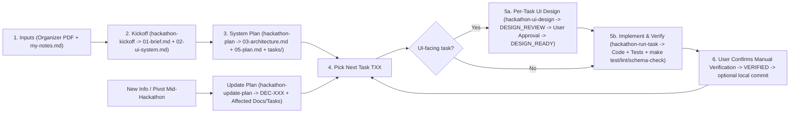

# Hackathon Development Workflow & Project Memory

This folder stores the **persistent project memory** for both **Antigravity** and **Claude Code** so every agent understands the goal, follows the same build/verification flow, and adapts smoothly when requirements change mid-hackathon.

## Artifact Map

| File | Purpose | Created / Updated By |
| --- | --- | --- |
| [`inputs/organizer-brief/`](inputs/organizer-brief/) | Raw organizer PDFs and challenge specs (tracked in Git) | User at kickoff |
| [`inputs/ui/`](inputs/ui/) | Brand assets and optional per-task screen sketches (e.g. `T02-dashboard.png`) | User anytime |
| [`inputs/my-notes.md`](inputs/my-notes.md) | User's rough notes, priorities, and mid-hackathon additions | User anytime |
| [`01-brief.md`](01-brief.md) | Timeline (deadline / demo / code freeze), goals, judging criteria, `REQ-XX` requirements, and MVP scope | `hackathon-kickoff`, `hackathon-update-plan` |
| [`02-ui-system.md`](02-ui-system.md) | Lightweight shared app shell, WCAG 2.2 AA light tokens, and UI primitives | `hackathon-kickoff`, `hackathon-ui-design`, `hackathon-update-plan` |
| [`03-architecture.md`](03-architecture.md) | Models, DRF endpoints, Next.js routes, env vars, and simplifications | `hackathon-plan`, `hackathon-ui-design`, `hackathon-update-plan` |
| [`04-decisions.md`](04-decisions.md) | Append-only Decision & Change Log (`DEC-001`, `DEC-002`, ...) | All workflow skills on every scope/design decision |
| [`05-plan.md`](05-plan.md) | Master task board (`TODO`, `DESIGN_REVIEW`, `DESIGN_READY`, `IN_PROGRESS`, `VERIFIED`, `CANCELLED`) | `hackathon-plan`, `hackathon-ui-design`, `hackathon-run-task`, `hackathon-update-plan` |
| [`tasks/_template.md`](tasks/_template.md) | Reusable template for individual verifiable task files (`tasks/TXX-*.md`) | Template reference |

## Quick-Start Cheat Sheet (Antigravity & Claude Code)

Invoke skills directly in **Claude Code** via `/skill-name` or ask **Antigravity** to run the skill by name:

1. **Add raw inputs:** Drop organizer PDF(s) into `docs/inputs/organizer-brief/` and write your notes in `docs/inputs/my-notes.md`.
2. **Distill brief (`/hackathon-kickoff`):** Reads the PDF + notes, asks any clarifying questions, generates `01-brief.md` (including deadline / code freeze) + lightweight `02-ui-system.md`, updates `AGENTS.md` brief, and logs `DEC-001`.
3. **Create task plan (`/hackathon-plan`):** Designs `03-architecture.md`, breaks MVP into verifiable vertical-slice tasks in `05-plan.md` + `docs/tasks/TXX-*.md`, and waits for your approval.
4. **Per-task UI design (`/hackathon-ui-design`):** Before coding a UI-facing task `TXX`, fills its `## UI Design (Per-Task)` section (screen layout, states, API fields, WCAG 2.2 AA checks), marks `DESIGN_REVIEW`, and moves it to `DESIGN_READY` only after you approve.
5. **Implement & verify (`/hackathon-run-task`):** Builds the vertical slice + unit tests, runs `make test`, `make lint`, `make schema-check`, `make migrations-check` (plus `make build-prod` when needed), gives you exact manual checks, and marks the task `VERIFIED` only after you confirm them.
6. **Add info / pivot (`/hackathon-update-plan`):** Anytime new requirements or feedback arrive, appends a `DEC-XXX` to `04-decisions.md` and updates impacted docs and tasks cleanly.
